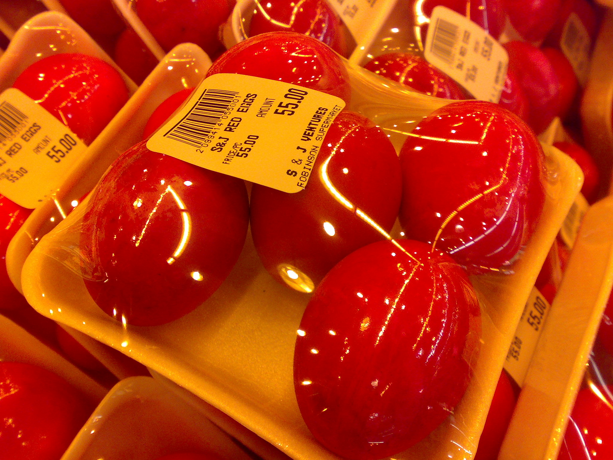

>> Ma go od 1994 roku.

Każdy warszawski tramwaj to mały parlament. Nikogo nie wybrano, każdy ma zdanie, a pani z wózkiem na zakupy ma głos ~~decydujący~~ rozstrzygający.[^1]

Jeżdżę siedemnastką od jedenastu lat. Ani razu nie usiadłem. Nie dlatego, że nie było miejsc — dlatego, że zawsze był ktoś, kto *wyglądał, jakby bardziej na to miejsce zasługiwał*, a ja byłem zbyt uprzejmy, żeby przegrać tę kłótnię we własnej głowie.

[Długa pauza. Komuś dzwoni telefon melodyjką z 2009 roku.]

> Uprzejmość to tchórzostwo z dobrą postawą.

>> Dział prawny prosił o zaczernienie jednego z nich.

Są zasady. Plecak zdejmujemy na Centrum. Żadnego kontaktu wzrokowego między Ratuszem Arsenał a Dworcem Gdańskim. Kiedy wsiada kontroler, każdy staje się ||prawnikiem||, turystą albo człowiekiem głęboko zainteresowanym oknem.[^2]

W zeszłym tygodniu starszy pan ustąpił mi miejsca. Nigdy nie byłem tak ~~upokorzony~~ obrażony i tak wdzięczny jednocześnie. Odmówiłem. Nalegał. Staliśmy tak, dwóch mężczyzn odmawiających sobie tego samego krzesła, aż tramwaj dojechał do zajezdni i motorniczy poprosił nas obu o opuszczenie pojazdu.

[Kłania się. Nikt nie klaszcze. Ktoś klaszcze.]

[^1]: W wózku są ziemniaki, kot albo jedno i drugie. Nikt nie sprawdzał.
[^2]: Autor bywał wszystkimi trzema, czasem podczas jednego przejazdu.
